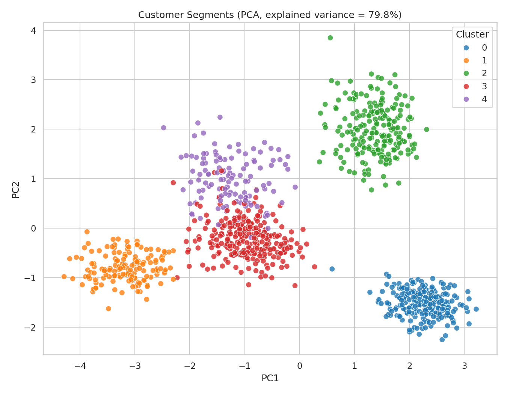
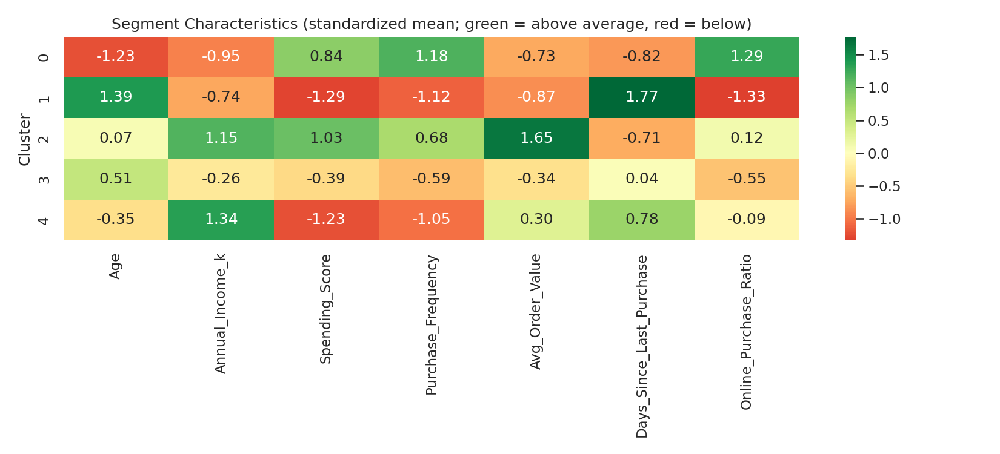

# Customer Segmentation Project

Customers ko unke **behavior (purchase patterns)** aur **demographics** ke basis par segments mein divide karne wala machine learning project. KMeans clustering (Python, scikit-learn) use karke targeted marketing insights nikaale gaye hain.

## Objective
- Customer data par clustering karna
- Purchase patterns aur customer preferences analyze karna
- Segments aur unki key characteristics visualize karna

## Tech Stack
- Python
- pandas, NumPy
- scikit-learn (StandardScaler, KMeans, PCA)
- matplotlib, seaborn
- Jupyter Notebook

## Dataset
1000 customers ka dataset (`customer_data.csv`) jisme ye features hain:

| Feature | Description |
|---|---|
| Age | Customer ki age |
| Gender | Male / Female |
| Annual_Income_k | Annual income (in thousands) |
| Spending_Score | Spending score (1-100) |
| Purchase_Frequency | Purchases ki frequency |
| Avg_Order_Value | Average order value |
| Days_Since_Last_Purchase | Last purchase ko kitne din hue |
| Online_Purchase_Ratio | Online purchases ka ratio |

> Note: Dataset synthetic hai (code se generate kiya gaya), real customers ka data nahi hai.

## Methodology
1. Data generation aur EDA (distributions, correlation heatmap)
2. Feature scaling using `StandardScaler`
3. Optimal clusters ke liye Elbow method aur Silhouette score
4. KMeans clustering (K = 5)
5. PCA se 2D visualization
6. Segment profiling aur business recommendations

## Results
KMeans (K=5) ka silhouette score **0.50** aaya. Ye 5 segments mile:

| Segment | Customers | Behavior |
|---|---|---|
| Average Occasional Buyers | 262 | Mid income, mid spending |
| Young Trendsetters | 251 | Young, frequent, mostly online buyers |
| Premium Loyalists | 220 | High income, high spending, bade orders |
| At-Risk / Dormant | 146 | Low frequency, kaafi time se purchase nahi kiya |
| High-Income, Low-Engagement | 121 | Income high, lekin spending kam |

### Segments (PCA view)


### Segment Characteristics


## Business Recommendations
- **Premium Loyalists:** VIP / loyalty program, early access offers
- **Young Trendsetters:** Social media campaigns, flash sales, referral rewards
- **High-Income, Low-Engagement:** Personalized recommendations, re-engagement emails
- **Average Occasional Buyers:** Seasonal discounts, combo offers, cross-selling
- **At-Risk / Dormant:** Win-back campaigns, discount coupons

## Repository Structure
```
├── Customer_Segmentation_Project.ipynb   # Main notebook (code + outputs)
├── customer_data.csv                     # Raw dataset
├── customers_segmented.csv               # Dataset with cluster labels
├── 04_pca_clusters.png
├── 06_segment_heatmap.png
└── README.md
```

## How to Run
```bash
pip install pandas numpy scikit-learn matplotlib seaborn jupyter
jupyter notebook Customer_Segmentation_Project.ipynb
```

## Future Scope
- RFM analysis
- DBSCAN / Hierarchical clustering ke saath comparison
- Real transactional data par apply karna
- Power BI dashboard

## Author
Varsha
